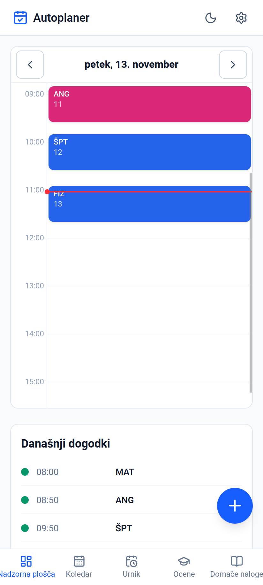
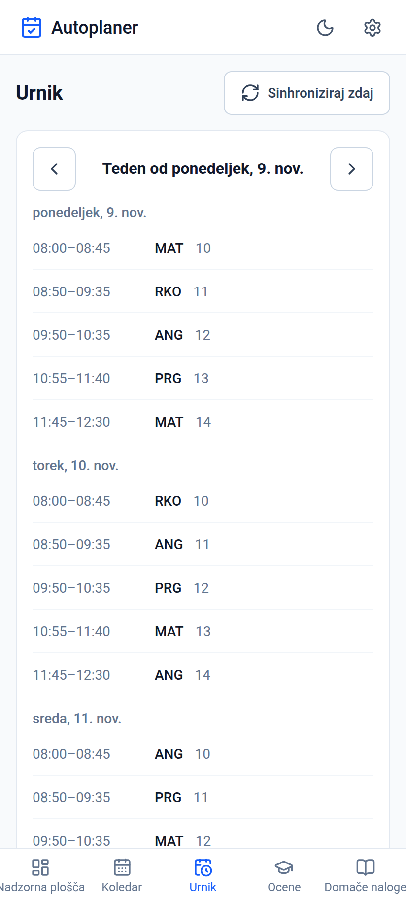
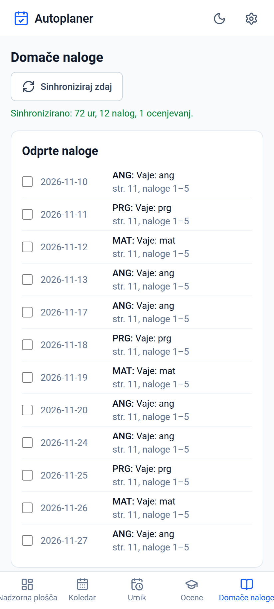
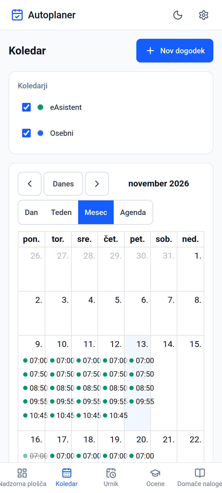

# Avtoplaner — predstavitev aplikacije

> Predstavitev za šolo: kaj aplikacija je, kateri problem rešuje in kako
> deluje od znotraj. Vsi podatki na posnetkih zaslona so sintetični
> (ustvarjeni za predstavitev — brez pravih šolskih podatkov).

## 1. Kaj je Avtoplaner?

**Avtoplaner je osebni koledar za Android in splet**, ki v enem mestu združi
tri vire dogodkov:

1. **Lokalni koledar** — ročno dodani dogodki, shranjeni naravnost v bazo na napravi.
2. **eAsistent** — šolski urnik, nadomeščanja in odpovedi, domače naloge ter
   napovedana ocenjevanja se samodejno sinhronizirajo.
3. **Google koledar** — dogodki iz Google računa prek varne OAuth 2.0 prijave.

Ključna lastnost: aplikacija je **offline-first in lokalna**. Ni strežnika,
ni računov, ni analitike — vsi podatki ostanejo izključno na napravi.

## 2. Kateri problem rešuje?

Danes so informacije o šolskem dnevu raztresene po več mestih: urnik v
eAsistentu, domače naloge po zvezkih, osebni dogodki v telefonu. To pomeni
rojenje po treh aplikacijah vsako jutro.

Avtoplaner te vire **združi v en koledar**, ki deluje tudi **brez interneta**
(in tudi takrat pokaže nazadnje sinhronizirane podatke).

## 3. Zaslonski posnetki

| Nadzorna plošča | Urnik | Domače naloge | Koledar |
| --- | --- | --- | --- |
|  |  |  |  |

## 4. Kako deluje — arhitektura

Aplikacija je napisana kot spletna aplikacija, zapakirana v nativno
Androidovo okolje:

- **React + TypeScript + Vite** — vmesnik in logika
- **Tailwind CSS** — izgled (svetla/temna tema)
- **SQLite** — lokalna baza podatkov (na Androidu prek nativnega vtičnika,
  v brskalniku prek WebAssembly)
- **Capacitor** — most med spletno kodo in Androidom (omogoča tudi
  lastne nativne vtičnike v Javi)
- **PWA** — namestitvena spletna različica z delovanjem brez povezave

### Pot podatkov (eAsistent sinhronizacija)

```
eAsistent API (urnik, naloge, ocenjevanja)
        │  prijava z žetonom (login → access token)
        ▼
  sinhronizacijska plast  ── normalizacija, odprava dvojnikov,
        │                    upoštevanje izbire skupin
        ▼
  lokalna SQLite baza  ── edini vir resnice za prikaz
        │
        ├── ▼ nadzorna plošča / urnik / naloge / koledar
        └── ▼ Android koledar naprave (prek DeviceCalendarPlugin)
```

- Sinhronizacija je **idempotentna**: ista podatkovna stanja vedno ustvarijo
  iste vrstice v bazi — podvajanj ni.
- **Samodejno** se sinhronizira ob odpiranju aplikacije (če je minilo več kot
  6 ur) in enkrat na dan v ozadju (WorkManager).
- Urnik se pridobiva v oknih po največ 14 dneh, ker to zahteva API.

### Varnost in zasebnost

- eAsistent geslo in Google žeton sta shranjena **samo lokalno** in sta
  **izključena iz varnostnih kopij**.
- Google prijava poteka po standardu **OAuth 2.0 s PKCE** brez strežnika —
  aplikacija uporablja vgrajen javni client ID, ki ga uporabnik lahko zamenja
  s svojim.
- Odjava izbriše žeton in vse sinhronizirane Google dogodke z naprave.

## 5. Zanimivosti razvoja

- eAsistent nima uradnega javnega API-ja — odjemalec je bil napisan samostojno,
  z raziskavo odprtokodnega referenčnega projekta (MIT).
- Brskalnik ne more klicati eAsistent API-ja (omejitev CORS), zato je
  sinhronizacija možna samo v Android različici; splet prikaže jasno obrazložitev.
- Napovedana ocenjevanja prihajajo iz urnika, ker ločen endpoint v praksi
  vedno vrača prazno.
- Objave sledijo različici: vsaka izdaja dobi podpisan APK in nov tag na
  GitHubu (trenutno v1.4.6).

## 6. Kaj še plane?

- Ocene (branje ocen iz eAsistenta)
- Obvestila, ko je aplikacija zaprta
- Širša PWA namestitev (GitHub Pages)

## 7. Povzetek v enem stavku

Avtoplaner je dokaz, da lahko ena oseba z odprtimi tehnologijami (React,
TypeScript, SQLite, Capacitor) zgradi polno vredno, zasebnost spoštljivo
aplikacijo — brez strežnika, brez računov, brez naročnin.
